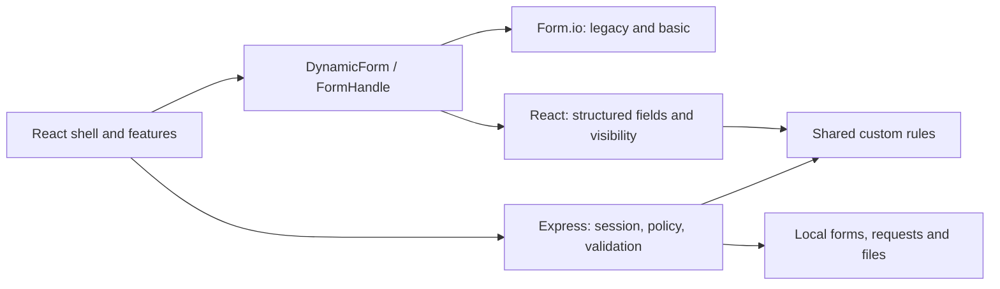

# Architecture and contracts

Local implementation reviewed on 28 October 2026. Setup and verification: [operation guide](handoff.md). Future architecture: [platform roadmap](platform-roadmap.md).

## Structure and decisions

- `src/app`: application entry, session lifecycle, locale, page selection and shared navigation/layout.
- `src/pages`: page composition for authentication/password changes, requests, user management and form management. Pages compose feature components; `App.tsx` selects the active page and applies session/admin guards.
- `src/features/requests/useWorkspace.ts`: request selection, browser history, async loading and unsaved-change guards. Local state/refs suffice for the current scope; no global store.
- `src/features/admin`: account/form authoring and permissions; `forms`: renderer integration; `requests`: save/review/history; `attachments`: upload/preview.
- `src/components/ui`: shared buttons/icons, menus, modals, errors and field styles. Admin dialogs preserve failed-save input, trap/restore focus and prevent closing during saves.
- `shared`: contracts, field parsing, visibility, validation and migration data types.
- `server`: authentication, form publication, request policy, snapshots and local files. The server derives identity/status/audit and validates every write.

`DynamicForm` selects React when fields contain array/object types or custom visibility; otherwise it uses Form.io. `FormHandle` keeps renderer details away from product/network state. Form.io hydration awaits `setSubmission` and evaluates conditions before enabling actions. Custom rules share frontend/API functions; legacy templates retain their own validator. The adapter does not remove schema coupling or compatibility work.

Tailwind styles React screens. `tooling/scoped-vendor.ts` scopes Bootstrap/Form.io selectors to `:where(.formio-surface)`, removes charset directives and places vendor CSS in its cascade layer. Structured React inputs stay outside that wrapper; portalled vendor content would need a scoped host. App typography and common field styles remain centralized.

## Authentication and permissions

Passwords use Node scrypt with a random 16-byte salt; bounds are 12 characters minimum and 256 UTF-8 bytes maximum. Credentials persist in private `users.json`; API responses omit hashes. Legacy Alex/Sam/Morgan accounts remain disabled until reset/enabled. New users have no form grants and must change their initial password.

The session cookie is HttpOnly, SameSite Strict, scoped to `/api`, with an absolute eight-hour lifetime. Use `SECURE_COOKIES=true` for HTTPS. Session/CSRF tokens are not stored in localStorage. Sessions and login counters are process-local; restart requires login again. Login allows 10 attempts per email and 50 per IP per 15 minutes; successful login clears only the email counter.

All API routes except health/login require a verified session. Login requires JSON and `X-Requested-With: RequestDesk`; authenticated mutations also require `X-CSRF-Token`. `x-demo-user` is ignored. Forced-change accounts may only access session/logout/change-password. Reset, disable, account edits and grant changes revoke affected sessions.

- **Admin:** manage users/forms and read all requests/schemas; no implicit create/review grant.
- **create:** create/edit own drafts and upload files; read own requests for that form.
- **view:** read all requests and linked files for that form.
- **review:** includes view and permits deciding another owner's submitted/in-review request. Self-review is rejected.

Removing every grant removes non-admin access even to owned requests for that form. Request history/upgrade/restore is restricted to the draft owner with create permission; admin/view/review does not grant access to another user's snapshots. UI visibility never replaces server policy.

Auth endpoints: `POST /api/auth/login`, `GET /api/auth/session`, `POST /api/auth/logout`, `POST /api/auth/change-password`. Admin account endpoints: `GET/POST /api/admin/users`, `PATCH /api/admin/users/:id`, `POST /api/admin/users/:id/reset-password`. Account changes cannot disable the last active admin or enable a user without a password. Exact schemas live in `server/auth/routes.ts` and `server/auth/account.ts`.

## Form authoring and publication

Admin chooses a legacy IT template or **Blank form**, configures fields, previews, saves a draft and publishes. Blank forms require at least one field. Publishing creates an immutable version and immediately advances the active pointer; new requests load it while saved requests use their pinned version. Publication approval and separate activation/rollback are future work.

The editor hides technical keys. New `tmp_` references become backend-issued `f_` identities on draft save; nested condition references are rewritten together. Rename/reorder keeps existing IDs. Existing explicit API/legacy keys remain valid. Duplicate sibling keys and missing condition targets are rejected; allocation checks draft/published history for collisions.

Supported fields: text, textarea, email, number, checkbox, date, select, multiselect, object, repeat and table. Validation includes required, length/collection bounds, numeric range/integer, valid calendar dates/emails and configured options. Required checkboxes must be checked; required collections must contain an item on submit. Nested container children have their own validation. Generated Form.io JSON does not encode all custom visibility semantics; `fields` remains authoritative.

Schema limits: 1–50 fields per sibling list, 100 options per select, 100 collection items maximum, 1–64 character safe field keys. Field JSON is bounded to 24 structural levels/6000 visited values; conditions to 16 levels/1000 values and 20 children per group. Arbitrary properties/scripts, prototype keys, incompatible types/bounds and duplicate options are rejected.

Visibility supports nested `and`/`or` with typed `eq`, `neq`, `contains` leaves. `root` is the entire submission, `row` the current object/row, `parent` its containing object; at top level all refer to root. References are direct keys, not executable/dotted expressions. Hidden fields skip validation and are omitted from saved data. Raw hidden input survives local toggles, but saving clears it; conditions depending on cleared input may differ after reload.

Form API:

- `GET /api/forms`: visible published catalog and effective grants.
- `GET /api/forms/:id` or `/api/forms/:id/versions/:version`: active or pinned definition.
- Admin `GET /api/admin/forms` and `/:id`: drafts, versions and audit.
- Admin `POST /api/admin/forms`, `PUT /api/admin/forms/:id/draft`: `{revision,name,description,template,fields?}`; creation uses revision 0.
- Admin `POST /api/admin/forms/:id/publish`: `{revision}`; also increments draft revision.
- Admin `PUT /api/admin/users/:id/form-permissions`: `{revision,formPermissions}`; replaces all grants using a separate permission revision and revokes sessions.

## Request lifecycle, files and history

`PUT /api/requests/:id` accepts `{revision,formId,formVersion,action,data,attachments}` with action `draft` or `submit`. New records must use the active form version; ordinary saves cannot change a saved record's type/version. Drafts may omit required values, but supplied values must validate. Submit requires complete visible fields, removes hidden/unknown values and locks requester editing. Stale revision returns a conflict; no silent merge.

`POST /api/requests/:id/review` accepts `{revision,decision,comment}`. Approve/reject applies only to submitted/in-review records; rejection requires a reason. Final decisions are immutable. There is no correction/resubmission workflow yet.

Files store real bytes: PDF/PNG/JPEG/TXT, maximum three per request and 5 MiB each. Upload policy/signatures and read access are checked; scanning/quarantine/retention are absent. Pending files require owner/create access and are bound to request/form. Uploads for unsaved requests require `X-Form-Id`; saved requests derive their form from the record. Linked file reads use request read policy. Snapshots can retain removed attachments.

For upgrades, save pending edits/files first, refresh versions, preview the latest active version, correct every invalid/missing required value, validate and explicitly confirm. Preview reports removed/hidden fields and preserves invalid supplied values for correction; it does not coerce types or infer rename mappings. Cancel does not write. Unlike ordinary draft saves, upgrades require a fully valid candidate.

- `GET /api/requests/:id/snapshots`: revision/version/time/actor metadata.
- `POST /api/requests/:id/upgrade/preview`: `{revision,targetVersion,data?}`.
- `POST /api/requests/:id/upgrade`: `{revision,targetVersion,data,confirm:true,token}`.
- `POST /api/requests/:id/restore/preview`: `{revision,snapshotRevision}`.
- `POST /api/requests/:id/restore`: `{revision,snapshotRevision,confirm:true,token}`.

The server recomputes candidates and checks revision, active target and SHA-256 fingerprint. The fingerprint binds preview contents; session/permission checks provide authorization. Changed saves/publications invalidate previews. Restore recreates exact historical data/files/form version as a new revision, preserving audit. Missing schemas/files/snapshots fail without mutation. Submitted/final requests cannot upgrade/restore; snapshot bodies remain internal.

## Persistence and compatibility

Users/forms/requests use local JSON; attachments have separate metadata/bytes. Request state, snapshots and audit are replaced atomically in one request-store write; this is not a transaction across stores or multiple processes. Detached reads protect internal state. All snapshots persist without compaction/retention.

On first initialization, form fixtures import into `.data/forms.json`; later edits to `forms/active.json` do not change the runtime pointer. Legacy requests gain `formId: request` with a `requests.pre-form-id.json` backup. Old role-based grants migrate once; intentional empty grants stay empty. Old draft state is captured before its first mutation. Missing historical attachment bytes are never fabricated. These compatibility paths must survive future engine/storage changes.
