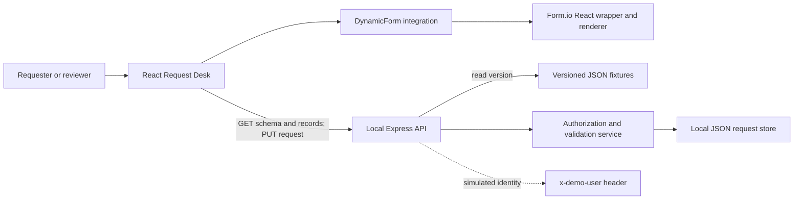

# Architecture and integration

## Working prototype



Form.io generates the fields, applies the two panel conditions and checks client constraints. React handles the surrounding product experience. No Form.io-hosted project is used. The browser receives JSON from our API and passes the object into the wrapper's `src` prop. When loading a record, it fetches the record first, then that record's form version and passes its data as `submission`.

## Load and submit sequence

```mermaid
sequenceDiagram
  actor User
  participant React
  participant Renderer as Form.io renderer
  participant API as Product API (local mock)
  participant Store as Request store
  User->>React: Open a saved request
  React->>API: GET /requests/:id
  API->>API: Check actor can read
  API-->>React: Record with formVersion and revision
  React->>API: GET /forms/request/versions/:version
  API-->>React: JSON definition
  React->>Renderer: Definition + submission + readOnly + locale
  User->>Renderer: Edit visible fields
  User->>React: Submit
  React->>Renderer: Validate final submission
  alt Invalid
    Renderer-->>User: Field errors; no API write
  else Valid
    React->>API: PUT id, revision, version, data, action
    API->>API: Check ownership, role, status, version, revision
    API->>API: Drop inactive values; validate business data
    API->>Store: Save record + audit
    Store-->>API: Write completed
    API-->>React: Updated record
    React-->>User: Submitted + read-only + activity
  end
```

Draft save skips required-field completeness but the API still checks field types, bounds, actor, version and revision. The demo file write is completed before success is returned. It does not simulate a distributed workflow transaction.

## Proposed customer integration (not implemented)

Reuse the existing product shell/session and replace `src/api.ts` calls with the product API contract. The API derives the actor from the verified session and reuses existing authorization policies. Persist `{formId, formVersion, revision, ownerId, status, data, attachmentIds, timestamps}` in existing entities. Store published definitions as immutable configuration records with an active version pointer. Use the product's existing file service and workflow capability; no new Form.io server is assumed.

Submission should validate ownership, schema compatibility and domain rules before saving. Persist the status change and audit in the existing database transaction. Use the platform's existing reliable workflow dispatch mechanism so a retried client call cannot trigger duplicate approvals. If that capability is absent, discover and estimate it explicitly rather than hiding it in the frontend estimate.

Use the existing application's session/CSRF conventions. Do not carry the demo header into production. Return scoped records from the API; hiding a button is not authorization. Logging must omit form payloads and file contents. Operational metrics: schema-load and submission error rates, submission latency, workflow handoff failures and failed file scans.

## Form configuration lifecycle

Proposed: author -> preview with sample data -> automated checks -> business/security review -> publish a new immutable version -> activate for new requests. Continue serving older versions. Roll back the active pointer for new requests; do not silently reinterpret saved submissions. New stored fields require backend contract support. Restrict publishable component types and external URLs; disallow unreviewed JavaScript rules. The current two local fixtures model version selection only.

## Accessibility and scale

Use associated labels, native buttons, visible focus, text status labels, error summary focus and live save feedback. Check keyboard order and screen-reader announcements in customer UAT; no WCAG conformance is claimed. The current language integration leaves some third-party hints and API diagnostics in English.

A full renderer is deliberately included for the assessment. Measure cold load on target devices and lazy-load the form route during integration. Use the existing database, pagination and object storage for actual workload; the demo file store is single-process only. Do not add infrastructure without customer load requirements.
