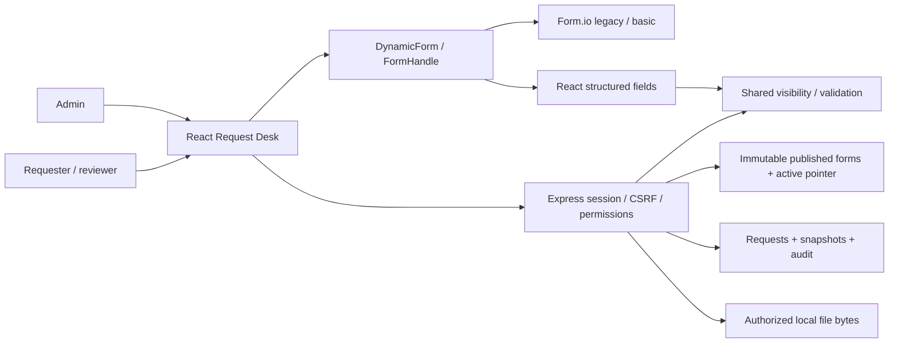

# Architecture and integration

Current local implementation, 11 October 2026. Customer infrastructure integration remains proposed.

React owns selected records, catalog, locale, navigation and network state. Renderer state stays behind `FormHandle`. `DynamicForm` keeps Form.io for legacy/basic definitions and selects the React renderer for array/object fields or custom visibility. Custom rules are declarative and use shared frontend/backend functions; arbitrary author JavaScript is rejected. Legacy Form.io conditions retain their existing independent API validation profile.

## Request and publication sequence

1. Login returns a server session cookie and CSRF token. Every read/write checks current account/grants.
2. New requests fetch the active published schema for the selected type. Existing requests fetch their pinned form ID/version.
3. Draft saves check types/bounds but allow missing required values. Submit checks completeness, ownership, status, revision and version. Hidden/unknown values are removed according to the applicable validator.
4. The store atomically replaces one request JSON file containing the record, draft snapshots and audit. Files have their own metadata/byte store; this is not a transaction across independent stores.
5. Reviewer decisions require the review grant and another owner's submitted/in-review request. The API records the decision and locks final states.
6. Publishing a saved admin draft creates an immutable version and moves the active pointer. It does not mutate any saved request.

## Confirmed draft transitions

Upgrade preview projects supported visible fields into the target schema, preserves invalid supplied values for correction and reports schema/data differences. The user edits the candidate and validates it; the API independently recomputes it. Confirmation binds revision, latest version and candidate contents through a SHA-256 fingerprint. Invalid or incomplete candidates cannot upgrade. Snapshots preserve the original draft; restore uses exact historical data/files/version and creates a new revision. See [protocol and persistence](draft-upgrades.md).

New supported field configuration is loaded from JSON without a frontend release. The [evidence test](release-independent-schema.md) verifies an unchanged built and served bundle plus unchanged requester document while publishing and using a new key. A new renderer input/operator, domain integration or external workflow still requires code and regression testing.

## Customer integration

Reuse the existing product session/SSO and scoped policies; replace local stores with the existing database, use approved scanning/object storage and reliable workflow dispatch. Persist request status/audit transactionally and make dispatch idempotent. Never trust client actor/status or rely only on hidden buttons. Keep immutable published versions, migration review and operational rollback/retention ownership.

Local sessions/rate limits are process-local. JSON persistence is single-process; no horizontal scaling or cross-store transaction is claimed. Measure target-device performance and accessibility separately. The Form.io dependency remains coupled to legacy/basic schema behavior; the adapter does not eliminate migration effort.
